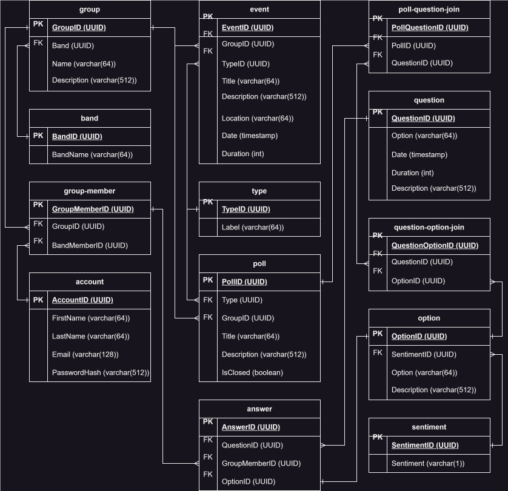

# NHB-APP Backend

This repository contains the backend and documentation for my M164 school project. The target of this project is to build a mobile software solution for workflows and organisation within our band called `NoHeadBand`. The frontend, `Angular-Ionic`, repository can be found [here](https://github.com/maknis3/nhb-app-frontend).

## Links and Documents

Within this readme I will outline general information, for further direct information and docuemntation consult the following links.

- [NoHeadBand Website (under construction)](https://noheadband.ch/)
- [NoHeadBand SocialMedia](https://www.instagram.com/noheadband_/)
- [Project Concept](/documentation/concept/concept.md)
- [Mockup](/documentation/frontend/mockup.md)
- [API-Endpoints](/documentation/backend/api-endpoints.md)
- [DB-Schema](/documentation/backend/db-tables.md)

## Deployment

This backend is containerised and deployed on my home-server. The frontend uses HTTPS requests to communicate with the node instance through a reverse proxy. For further detail consult the [concept](/documentation/concept/concept.md). The backend can be accessed using the following domain.

```plaintext
https://nhb-app.dbernet.ch
```

### Containerization

Build your own docker image following this guide or pull from my [dockerhub repository](https://hub.docker.com/r/maknis3/nhb-app-backend) or directly using the following command.

```bash
docker pull maknis3/nhb-app-backend
```

#### Containerisation Guide

Build container image using the following command.

```bash
docker build -t nhb-app-backend .
```

Push container image to docker-hub using the following command.

```bash
docker image push maknis3/nhb-app-backend:latest
```

## Local Setup

### Node & Node Modules

To run the node backend instance (without docker) locally start by ensuring that `Node` and the accompanying package manager `npm` are installed. You can accomplish this using the following commands. If neither one is installed consult the [public documentation](https://docs.npmjs.com/downloading-and-installing-node-js-and-npm) for a step by step installation guide.

```shell
node --version
npm --version
```

Now Download the source code. Navigate to the project **source folder**. Next you need to install the node-modules using the following command.

```shell
npm install
```

### Database Configuration

This project is developed and tested for `PostgreSQL 15`. There for, if possible, install the appropriate version.

#### Online Hosting

For online database hosting, obtain a free PostgreSQL database using providers like:

- [Neon](https://neon.tech/)
- [ElephantSQL](https://www.elephantsql.com/)
- [Hasura](https://hasura.io/)
- [Aiven](https://aiven.io/)

#### Local Hosting

For local database setup, follow these steps:

1. Install PostgreSQL using the [official installer](https://www.enterprisedb.com/downloads/postgres-postgresql-downloads).
2. Configure the database according to [this guide](https://www.prisma.io/dataguide/postgresql/setting-up-a-local-postgresql-database).

### Environment Configuration

Create a `.env` file in the root of your backend directory with the following variables, adjusted to your database, to configure database connection parameters:

```plaintext
DEV_DB_HOST=localhost
DEV_DB_USER=postgres
DEV_DB_PASS=postgres
DEV_DB_NAME=nhb-app
DEV_DB_PORT=5432

DEV_BACKEND_PORT=9001

JWT_SECRET=my-secret-jwt-key
```

### Initialize Database

Create the database using the name specified in the `.env` file. Then migrate and seed the database using Sequelize (recommended). Alternatively the [SQL database dump](/documentation/sql-scripts/nhb-app-db-dump.sql) can be used to create and seed the database. In this case the database-name of `nhb-app` is forced (adjust .env accordingly).

```shell
npx sequelize-cli db:migrate
npx sequelize-cli db:seed:all
```

Finally the backend can be started using the following command.

```shell
node server.js
```

## Concept & Mockup

As part of this project i was required to write a concept and create a mockup of this project. These files can be found using the following links.

- [Project Concept](/documentation/concept/concept.md)
- [Frontend Mockup](/documentation/frontend/mockup.md)

While working on this project, required for the concept, I've made a project plan. This plan details project milestones as well as keeping track of time investment and work. The project plan can be found [here](/documentation/project_plan.xlsx).

## API-Endpoints Documentation

All awailable api endpoints, implemented as part of this project, are documented in [this](/documentation/backend/api-endpoints.md) markdown file.

## Database Structure

An overview of all the database tables can be found [here](/documentation/backend/db-tables.md). To further understand the cardinality and associations of these tables review the following erd.



## Project Component structure

The projects components are set up as displayed in the following component diagram. For further detail consult the [project concept](/documentation/concept/concept.md).


## Backend Documentation

### Backend Structure

The backend makes use of the `node-express-sequelize` stack and follows the basic backend organisation principle. The following links redirect to the appropriate folder. The entrypoint resides within the `server.js` file in the root directory.

- [Middleware](/middleware/)
- [Migration](/migrations/)
- [Models](/models/)
- [Routes](/routes/)
- [Seeders](/seeders/)

The models and routes `index.js` files defines and implements the according objects and routes.

- [/models/index.js](/models/index.js)
- [/routes/index.js](/routes/index.js)

### Sentiment

The sentiment table on the DB describes how an answer-option should be evaluated. The following character representations are present.

| SentimentID | Character | Sentiment  | Usecase                           |
| ----------- | --------- | ---------- | --------------------------------- |
| 1           | u         | unanswered | standart for unanswered questions |
| 2           | n         | no         | negative response                 |
| 3           | y         | yes        | positive response                 |
| 4           | i         | irrelevant | the response is irrelevant        |

### Types

The type table is a classificaton for events and polls. The following types exist on the database as part of this project. Additional entries will or should be available in the future. Does it make sense for the users to create their own types?

| Type        | Description                                           |
| ----------- | ----------------------------------------------------- |
| gig         | A gig is an event where the group plays               |
| rehearsal   | A rehearsal is an event where the group practices     |
| stamm       | A stamm is a casual band meetup                       |
| meeting     | A meeting is a planning and organisational band event |
| unspecified | Unspecified is the default without any implications   |

### Band

As part of this project, for simplicitys sake, the `Band` table will only contain our band, `NoHeadBand`, as multi-band capabilities will be part of future development.

### Option

Options will be hardcoded for the time beeing. An answer always starts out with the default, `unanswered`, option. Option creation would be a debatable future feature. Do users need the capability to create options? Would band a band specific option be a sensible compromise? The following options are momentarely available.

| SentimentID | Option           | Description                                |
| ----------- | ---------------- | ------------------------------------------ |
| 1           | unanswered       | Standart for unanswered questions          |
| 2           | no               | Give a negative answer                     |
| 3           | yes              | Give a positive answer                     |
| 4           | i don't know yet | Pass up on giving an answer at this moment |
| 4           | i don't care     | Give undefinitive answer                   |

### Migration scripts

To migrate and set up my database I make use of the sequelize migration and seeder script capabilities. To respect the project-requrements I've translated all the migration and seeder scripts in to the postgres SQL-dialect. The corresponding files are deposited [here](/documentation/sql-scripts/). There is also a general sql database dump that achieves the desired database state with one script deposited [here](/documentation/sql-scripts/nhb-app-db-dump.sql).

## Future of this Project

This project represents `V1.0` of my `BandManager` mobile application. It is more or less a prototype, a proof of concept, as it needs further improvement, features, development and feedback for it to be viable for real world implementation.

### Implementation within Band

As previously stated are many more features needed to implement this application within our band. To achieve this I would like to create a team within our band to act as stake holders with whom I would continue refinement and development. Further integrating two other developers, also band members, in to the development would be aspiring.

### Future Features

The following features and development is needed to refine the momentary implementation for future proofing this application (cut corners for this project).

- User friendly and appealing UI and UX
- All date formats should contain a timestamp, not only a date
- Splash screen and app icon
- DB backup system
- Implement virtual scroll (depricated, search alternative) for group feed
- Move the type indicator from `Poll` to `Question` as one poll could be containing diffrent types of questions (one poll for gig and and rehearsals)

The possible future features for this application, based ony research, discussions with bandmembers and brain storming, are as follows. These aren't requirements rather a list of possibilitys and ideas.

- Group and project administration
  - You should be able to create groups for projects and gigs with specific members
  - There is a global group with all band members for general events (ie. GV, NHB-Stamm, rehearsal weekend)
  - You should be able to create groups out of global gig polls
- Date management
  - You should be able to make global polls for possible gigs to determen cast and feasability
  - Band members should be able to make date polls for rehearsals
  - You should be able to directly create rehearsals or gigs from a poll result
  - Rehearsals, gigs and events should be added directly to the personal calendar
  - You should recieve reminders for rehearsals, events and gigs in a set time in advance
  - Band members should be able to view a global band calendar with all rehearsals, gigs and events
  - Band members should be able to integrate the application events in to their personal calendar
- Absence management
  - Band members should be able to remark attendance for rehearsals or gigs
  - Band member attendance should be carried over from the origin poll, if answered
  - Band members should be able to change attendance until a set time in advance
  - Upon attendance change in a given narrow time frame before the rehearsal or gig the group will be notified
- Communication
  - The hole band should be reachable through a global communication channel
  - The band members should be able to communicate on a group level for gig or rehearsal specific communication
- Repertoire
  - The band members should be able to view and print the sheet music
  - Specific band members should be able to upload and edit sheet music
  - The sheet music should be versioned
  - There is a band member specific overview of wich songs have already been played, there for are already known
  - The band member should be able to rate their knowledge of a song on a scale
  - The repertoire for a specific gig should be defineable and orderable (set list)
  - Band members should be able to deposit song suggestions
- Media sharing
  - The band members should be able to upload pictures, videos and audio files of gigs and events
  - Band members should be able to view a media feed of the uploaded pictures, videos and audio
- Merch
  - The band members should be able to make internal detailed merch orders
  - Band members should be able to regristrate twint transactions in a feed or channel to the concerning band member
- Password management
  - Band members should be able to view, save and edit personal band specific passwords
  - Band members should be able to view, save and edit role specific passwords (ie. social media, website)
  - Band members should be able to view general passwords (ie. google drive)
- Roles
  - There should be diffrent roles with specific rights, possible roles:
    - gig manager
    - board member
    - sheet music manager
    - password manager
    - web master
  - Band members should be able to posess multible roles, tag like
- User management
  - The user should be able to set a profile image
  - The user should be able to edit notification settings
  - The user should be able to set playable instruments

## Learnings

As part of this project I've overcome the following hurdles and made the regarding learnings.

- general uniform variable naming, use same variable names within backend and frontend as well as across frontend pages
- Rxjs Observables, their utility and handling
- Angular tab-routing
- Sequelize modeling, routing and associations
- Angular interceptors
