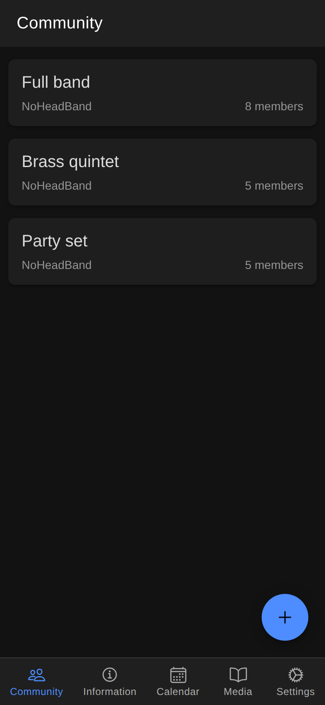
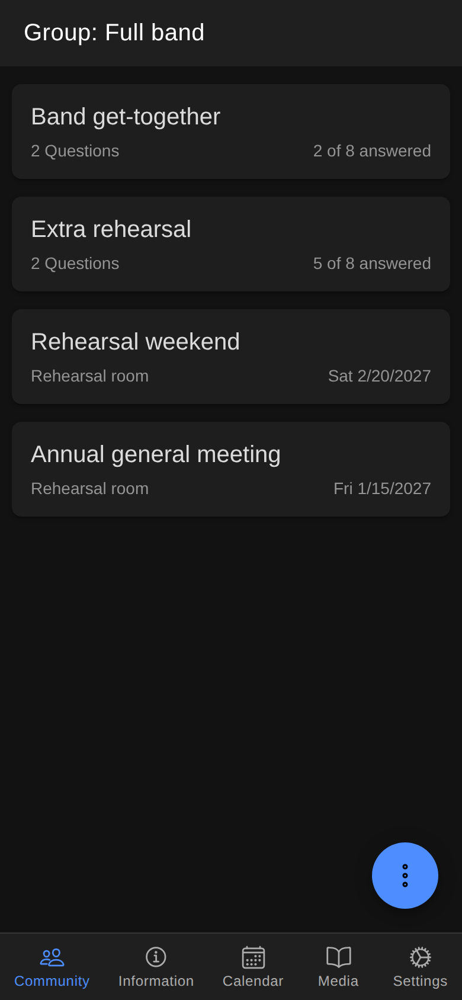
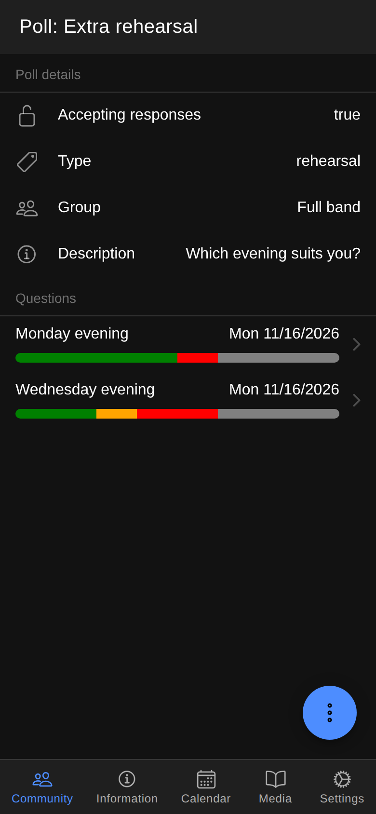

# NHB-APP backend

REST API and project documentation for a band-organisation app prototype that I built as a school project (apprenticeship, 2024).

<p>
  
  
  
</p>

*Screenshots from a local run with the made-up demo data. The frontend is in [nhb-app-frontend](https://github.com/daniel-bernet/nhb-app-frontend).*

## What and why

My band, [NoHeadBand](https://noheadband.ch/), organised itself in a WhatsApp community: polls to find rehearsal dates, line-ups for each gig, and a chat per group. The idea was to put that into one app. I built it alone in June 2024, as a school project during my apprenticeship.

The prototype covers:

- **Accounts:** register, log in (JWT), change name, email and password, delete the account.
- **Groups:** line-ups within the band (for example a quintet for a reception) with their members.
- **Events:** gigs, rehearsals, meetups and meetings with date, place and duration.
- **Polls:** several questions per poll (for example one per possible date), answered with yes, no or "don't know yet". From a question you can create a group or an event.

This repository contains the API (Node.js, Express, Sequelize, PostgreSQL) and the documentation written for the project:

- [Concept](documentation/concept/concept.md): situation, requirements and technology choices, written before development
- [Mockup](documentation/frontend/mockup.md): wireframes of the planned screens
- [API endpoints](documentation/backend/api-endpoints.md) and [database tables](documentation/backend/db-tables.md)
- [ERD](documentation/concept/assets/ERD_NHB-APP.svg) and [component diagram](documentation/concept/assets/component_diagram_NHB-APP.svg)
- [SQL scripts](documentation/sql-scripts/): the migrations and seeders translated to plain SQL, plus a dump with demo data
- [Project plan](documentation/project_plan.xlsx): weekly plan and time tracking

## Result

A working prototype: this API and an Ionic frontend, which I ran in containers on my home server for the presentation. I also built the Android app and tested it on a phone as a proof of concept. I presented it as a school project in June 2024.

We didn't use it in the band afterwards. We talked about it, but WhatsApp was good enough for us, and the remaining work wasn't worth it.

What I learned along the way: modelling associations and cascading deletes in Sequelize, RxJS observables, Angular tab routing and HTTP interceptors, and keeping names the same across backend and frontend.

## How to run it

You need Node.js (tested with Node 24) and PostgreSQL 15. The quickest way to get the database is Docker:

```bash
docker run -d --name nhb-postgres -e POSTGRES_PASSWORD=postgres -p 5432:5432 postgres:15
```

Load the demo data (the dump creates the `nhb-app` database itself):

```bash
docker exec -i nhb-postgres psql -U postgres < documentation/sql-scripts/nhb-app-db-dump.sql
```

Or start with an empty database instead:

```bash
docker exec nhb-postgres createdb -U postgres nhb-app
npx sequelize-cli db:migrate
npx sequelize-cli db:seed:all
```

Then configure and start the API:

```bash
cp .env.example .env   # set DEV_DB_PASS=postgres and a JWT_SECRET
npm ci
node server.js         # http://localhost:9001
```

The demo accounts are `anna@example.com` to `hugo@example.com` with the password `demo1234`. The seeders also create `test@test.com` with the password `Test1test`.

With Docker, after creating `.env`:

```bash
docker build -t nhb-app-backend .
docker run --rm -p 9001:9001 --env-file .env -e DEV_DB_HOST=host.docker.internal --add-host=host.docker.internal:host-gateway nhb-app-backend
```

The frontend expects the API at `http://localhost:9001`; see its [README](https://github.com/daniel-bernet/nhb-app-frontend#how-to-run-it).

## Limitations and status

This is a finished school project and isn't maintained. The tag `v1.0` marks the state I handed in. The later commits only make it run from a fresh clone and clean up the documentation.

- **No authorisation checks.** Most endpoints only check that a user is logged in, not that they belong to the group. Any logged-in user can, for example, delete any group, poll or event.
- `GET /` returns 404 instead of "Hello World!", because the 404 handler is registered before that route.
- `POST /group/create` creates the group but returns `"group": null`, because it reads the group back before the transaction commits.
- Poll questions store their creation time instead of a date.
- `npm audit` reports known vulnerabilities in the dependencies (24 in November 2026, 3 of them critical). I haven't updated them.
- There are no automated tests.
- Only one band is supported.

Not built: calendar sync and reminders, chat and notifications, and a repertoire with sheet music.

## Licence

The code is under the [MIT licence](LICENSE). The documentation and my own images (screenshots, diagrams and mockups in `documentation/`) are under [CC BY 4.0](https://creativecommons.org/licenses/by/4.0/). Third-party parts keep their own licences.

## Credits

- The mockups and diagrams were drawn in [draw.io](https://www.drawio.com/), using its icons and shapes.
- `documentation/project_plan.xlsx` is based on a Microsoft Excel template.
- The npm dependencies listed in `package.json` are under their own licences.

## Project page

[dbernet.ch/projects](https://dbernet.ch/projects/)
