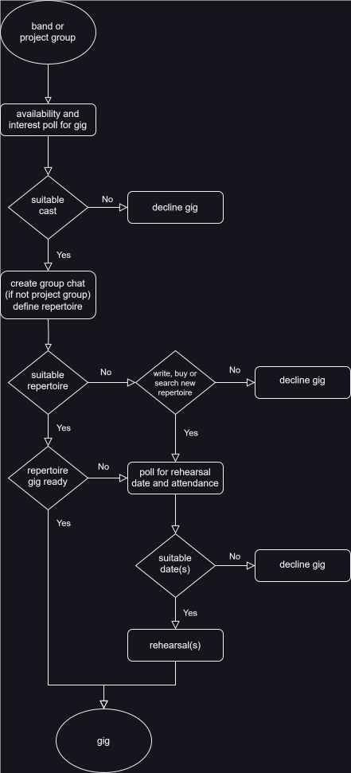
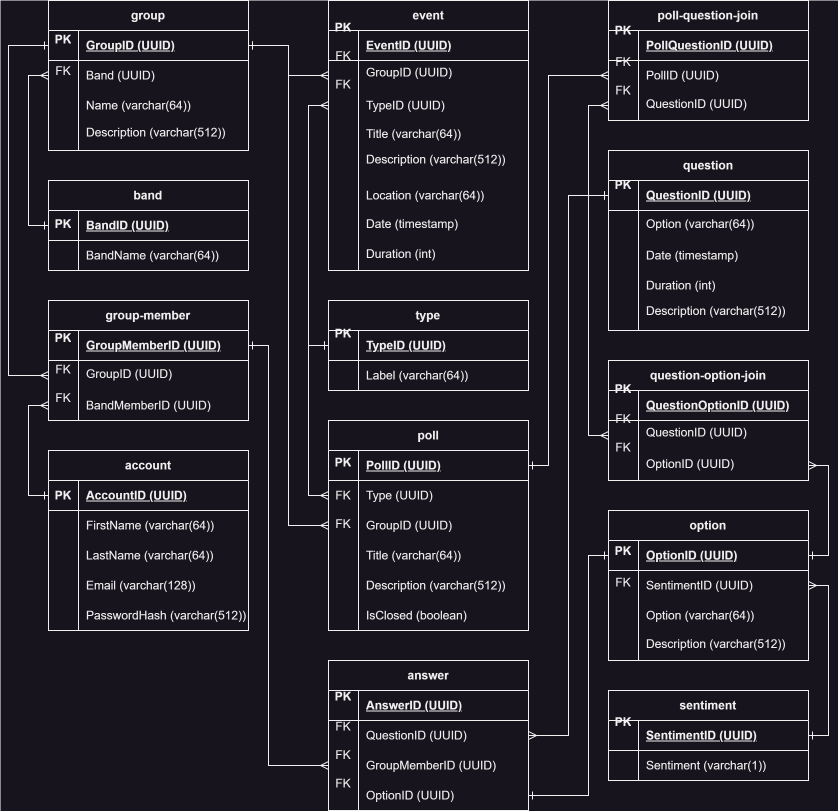
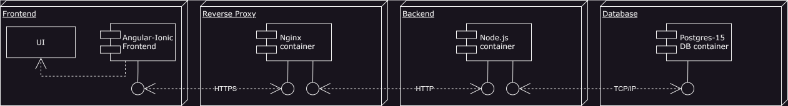

# NHB-APP Concept

> This is the concept as I wrote it before development, in June 2024. Some plans here (for example a progressive web app or WebSockets) were not built. The [README](../../README.md) describes what the prototype actually does.

## Introduction

### Target

The Target of this project is to build a software solution for our band and members to ease organisation, communication and planning.

### Why this project?

I find that our organisation works generally great despite the usage of unoptimized and unconventional solutions at the cost of time and complexity. I would like to consolidate all workflows and administation within one application to ease the workload and further improve information density, communication clarity and speed.

## Situation

### The Band

I'm part of a band called `NoHeadBand`. The band consists of 24 members with a wide variety of instruments ond limited free time. We play very flexible in relation to our repertoire (ländler, pop, rock, jazz etc.), composition (generally groups of 5 to 10) and events (from birthday parties to festivals). There for we have a lot of internal organisation for group casting for specifig gigs, attendance clarification, rehearsal date search, repertoire communication and date management.

### Target group

The target-group of this project consists of the members of our band with sole member roles as well as distributed administrator roles. Most of our members aren't that technologically savy. Further use most of our member their mobile device for daily communication, band-work and general digital interagtion. There fore would a progressive web application be most desirable. This solution would further ease the implementation of a web-browser implementation in a future step. Our band uses primeraly android devices with a minority of one quarter using an apple smartphone. Finally it would be important to say that the target group would most likely only accept a solution solving all problems within one application. A software solution wich would still involve paralell work will most likely rule out any implementation of the new software solution.

### Workflow band to gig

The following diagram describes our basic internal workflow for a gig request. Followingly I will analyse key features and important corner stones.

The general band to gig workflow contains three prevalent make or break decisions. Two of these decisions encompass the availability of the band members for eather the gig itself or rehearsals. The third (second within the flow-chart) refers to the presense of suitable repertoire for a specific gig. There for is my first conclusion that date-polls and availability of the band members are crucial for a successful gig (also observable in practise). Creating this workflow, especially the group and rehearsal/gig creation out of a poll, in a click trough stile software solution would be admirable and significantly decrease the workload and cross software information distribution. The implementation of the poll entity within a sensable ORM matter will be rather challenging and complex but valuable learning experience. Further observable is the significance of the repertoire knowledge and abundance within our band. There is a part of our band members that are rather knowledgable of a wide portion of our repertiore, on the other hand there are a lot that haven't or have rarely played a given set of songs. There for it would be rather beneficial if the band members could judge their knowledge of a song as well as a user and song specific played-at-gig counter. This song-knowledge overview would help assessment of rehearsal needs in advance as well as within a rehearsal-date-poll. On time sensitive gig requests the song-knowledge would already be taken in to consideration at the start, within the initial cast search, there for a public user specific overview would be enriching.

### Active solution

At the moment the core part of the bands organisation works based on a WhatsApp-Community. Mainly used are the poll feature, multible group specific chats within the community and the chat functionalities. Further rely alö band members on a personal calendar. Finally all sheet music, photos, videos and audio is managed on one drive, perviously nextcloud.

## Project requirements and future features

### Possible features

The following list of features are derived from the previous workflow analysis, active occurances within our band as well as feature-wishes, either personal or gathered from discussions with other band members.

- Group and project administration
  - You should be able to create groups for projects and gigs with specific members
  - There is a global group with all band members for general events (ie. GV, NHB-Stamm, rehearsal weekend)
  - You should be able to create groups out of global gig polls
- Date management
  - You should be able to make global polls for possible gigs to determen cast and feasability
  - Band members should be able to make date polls for rehearsals
  - You should be able to directly create rehearsals or gigs from a poll result
  - Rehearsals, gigs and events should be added directly to the personal calendar
  - You should recieve reminders for rehearsals, events and gigs in a set time in advance
  - Band members should be able to view a global band calendar with all rehearsals, gigs and events
- Absence management
  - Band members should be able to remark attendance for rehearsals or gigs
  - Band member attendance should be carried over from the origin poll, if answered
  - Band members should be able to change attendance until a set time in advance
  - Upon attendance change in a given narrow time frame before the rehearsal or gig the group will be notified
- Communication
  - The hole band should be reachable through a global communication channel
  - The band members should be able to communicate on a group level for gig or rehearsal specific communication
- Repertoire
  - The band members should be able to view and print the sheet music
  - Specific band members should be able to upload and edit sheet music
  - The sheet music should be versioned
  - There is a band member specific overview of wich songs have already been played, there for are already known
  - The band member should be able to rate their knowledge of a song on a scale
  - The repertoire for a specific gig should be defineable and orderable (set list)
  - Band members should be able to deposit song suggestions
- Media sharing
  - The band members should be able to upload pictures, videos and audio files of gigs and events
  - Band members should be able to view a media feed of the uploaded pictures, videos and audio
- Merch
  - The band members should be able to make internal detailed merch orders
  - Band members should be able to regristrate twint transactions in a feed or channel to the concerning band member
- Password management
  - Band members should be able to view, save and edit personal band specific passwords
  - Band members should be able to view, save and edit role specific passwords (ie. social media, website)
  - Band members should be able to view general passwords (ie. google drive)
- Roles
  - There should be diffrent roles with specific rights, possible roles:
    - gig manager
    - board member
    - sheet music manager
    - password manager
    - web master
  - Band members should be able to posess multible roles, tag like
- User management
  - The user should be able to set a profile image
  - The user should be able to edit notification settings
  - The user should be able to set playable instruments

### Project requrements

As a starting point, in respect for the timeframe and complexity, for this endeavour and the scope of this school project I would like to define and limit myself to the following requrements.

- Basic user management
- You should be able to create groups for projects and gigs with specific members
- There is a global group with all band members
- You should be able to make global polls for possible gigs to determen cast and feasability
- You should be able to create groups out of global gig polls
- Band members should be able to make date polls for rehearsals
- You should be able to directly create rehearsals or gigs from a poll result

Most importantly I want to take future features and development, at every step of this project, in to consideration and implement accordingly. For example the implementation of multi-band capability would exceed the scope of this project, yet without precaution at this state will, without appropriate preparation and consideration, exponentially increase work and complexity down the line.

## Database

### ERD

Each table further contains the fields `created_at` and `updated_at` not shown within the ERD.

### Database description

For this project I will use a Postgres-15 DB deployed as a docker-container on my linux-based home server.

### Why this DB?

My DB choice is based on previous projects and experience as well as availability. I know that postgres runs flawlessly on my server. Further enjoys postgres all the advantages of open-source developed software.

## Backend

### Backend Technology

In respect to the backend technology for this project I was first devided between `Node.js` in combination with `Express.js` and `sequelize`, `python` with `flask` and `sqlalchemy` and finally `java` with `hibernate`. I've already worked extensively with the python-sqlalchemy combination for an other school project. Further do I work with the javascript-stack at this moment within the scrum-school-project. In the case of hibernate with java I've no previous experience. There for I've decided to work with the javascript-stack, as I'm already within the matter, making switches between the project smoother, as well as reduce the workload, as the project is already challenging and complex enough.

### Backend Deployment

The backend will be deployed as a docker container in similar fashion and alongside the postgres-db on my linux based home server. The frontend will access the backend using a dyn-DNS with a locally hosted reverse proxy using the `https` protocole. For further feature implementation such as chat functionality or notifications the implementation of the `wss` protocole would be desirable.

### Backend Documentation

Backend related documentation can be found using the following links.

- [API-Endpoints](../backend/api-endpoints.md)
- [DB-Schema](../backend/db-tables.md)
- [Setup and deployment](../../README.md#how-to-run-it)

## Frontend

### Frontend Technology

For the frontend side of this project I was torn between `Flutter` and `Angular-Ionic`. I've previously worked with Flutter for a school project involving a shoppinglist management mobile application. On the other side am I currently attending a course where we employ the Angular and Ionic combination. There for I've decided to go with Angular and Ionic as I'm not as well versed with these frameworks and would like to deepen my understanding and secondly I expect the transition from progressive web app to website to website to be more natural and handable.

### Frontend Deployment

For the scope of this project I will deploy my application on my own device. Any publishing on distribution services, for example play-store or f-droid, are rather infeasable in a software-rights standpoint as well as timeframe. As development envoronment I will heavely rely on the brwoser development tools as well as emulators.

### Frontend Documentation & Mockup

Frontend related documentation and mockup, including description, can be found using the following links.

- [Mobile application Mockup](../frontend/mockup.md)

## Component diagram

The following diagram displays the components of this project and their connection. I wont further go in to detail as I've talked about every part of this diagram in previous chapters.

## Project planning

My project planning can be viewed within [this](../project_plan.xlsx), continuously evolving, excel document. The past timeline of the project-plan displays the active work and development done as part of this project.
