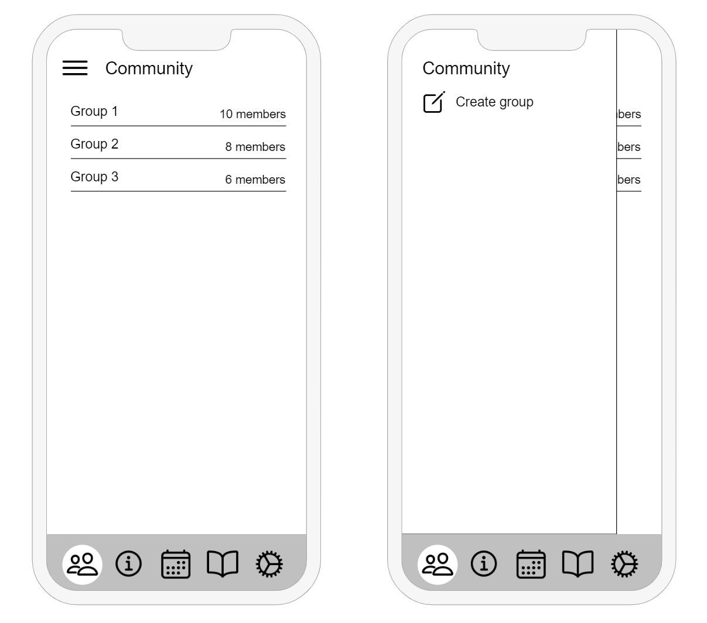
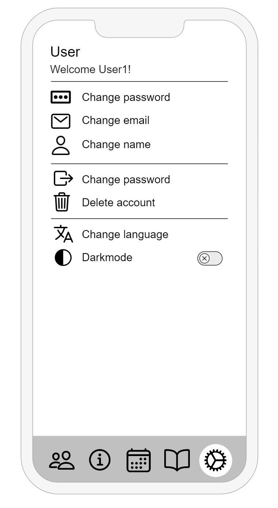

# Mobile Application Mockup

## General Overview

The mobile application is designed with a tab-based structure that maintains route persistence across sessions. This ensures that the user's last viewed tab is restored upon revisiting the application. Access to this tabbed interface requires user authentication. The main tabs that I will be implementing as part of this project are:

- **Community**: For group interactions and activities.
- **User**: For personal account management.

## Splash Screen, Login & Registration

The application includes an engaging splash screen leading to the authentication pages. Users can either log in or register. Each page provides a link to the other to ease navigation between logging in and signing up. The registration form validates input locally before submission and includes a confirm password field (not shown in the mockup) to verify user password input. Successful authentication directs the user to the community page.

## Community

The community tab serves as the central hub for user interaction with their groups. It displays a list of groups the user is a member of, and selecting a group takes the user to that group's specific page. This tab also offers features for creating new groups, with potential future enhancements including band filters, group name searches, and member searches.

The group page organizes notifications from events, polls, and chats chronologically. It includes a chat interface at the bottom, alongside options for creating new polls and events, and sending media or audio files. The group menu provides further actions such as editing the group description, managing memberships, and filtering group content by type (events, polls, etc.). Selecting an event or poll opens its detailed page. The following functionalities will be developed as part of this project:

- Display of group content
- Creation and management of events and polls
- Group  modifications (editing description and group delition)
- Member management options (adding and removing members as well as leaving the group)

The event page is accessible through event selection on the group page. It provides detailed information about the event, including location, date, time, and description, along with options to edit or delete the event. The implementation within this project will focus on:

- Display and edit event details
- Delete events

The poll page will follow a similar layout and functionality to the event page. Additional development will focus on integrating suitable Ionic components for creating polls and events, ensuring a seamless user experience. The mockup for this functionalities haven't been created yet, as I'm not well versed with ionic-components and there for am not aware of all the capabilities provided by ionic. Further research, as part of the development process, will provide more insight in to the design options and define the look and feel in a agile-like development process.

## User

The user tab is dedicated to personal account management and application settings. The following features are going to be implemented as part of this project:

- User profile updates (name and email)
- Password changes
- Account deletion

These functionalities will provide users with full control over their account settings and personal information.

## Final remarks

I've breafly worked with the ionic-angular technology as part of a 5-day ÜK. There for I'm not well versed within the ionic environment. This said this mockup is more of a guidline and help for frontend development as I'm going to be discovering the capabilities and options of ionic and its components resulting in a, most likely, uncomparable look and feel in the final frontend implementation of this application.

## Final Remarks

My experience with Ionic-Angular technology was briefly over a five-day ÜK. Consequently, I am not that familiar with the Ionic framework. Given this, the provided mockup primarily serves as a guideline for the frontend development process. As I discover the extensive capabilities and components offered by Ionic, the actual implementation may there for differ significantly in both look and feel as well as functionality from this initial design.
