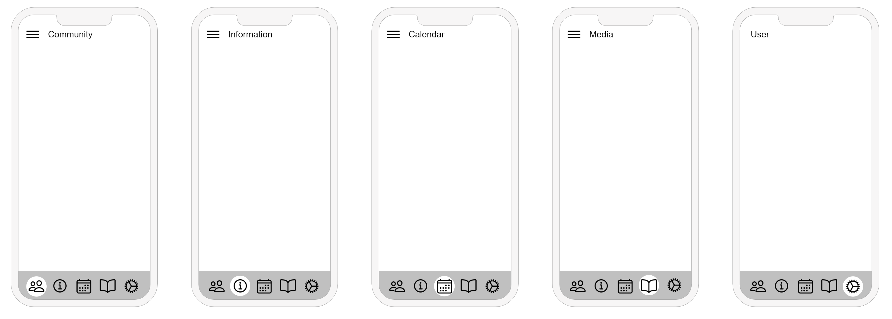
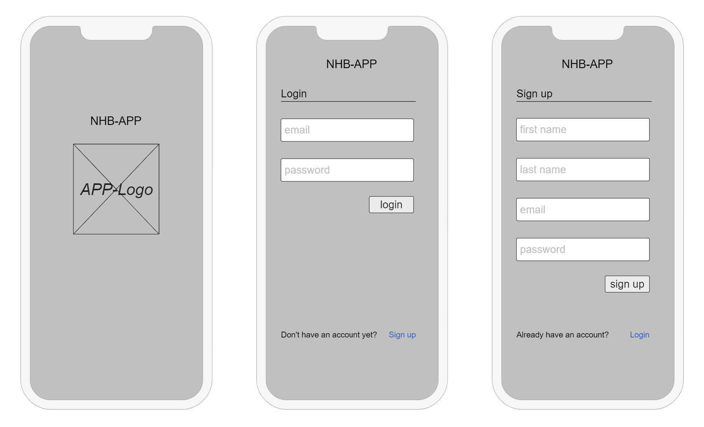
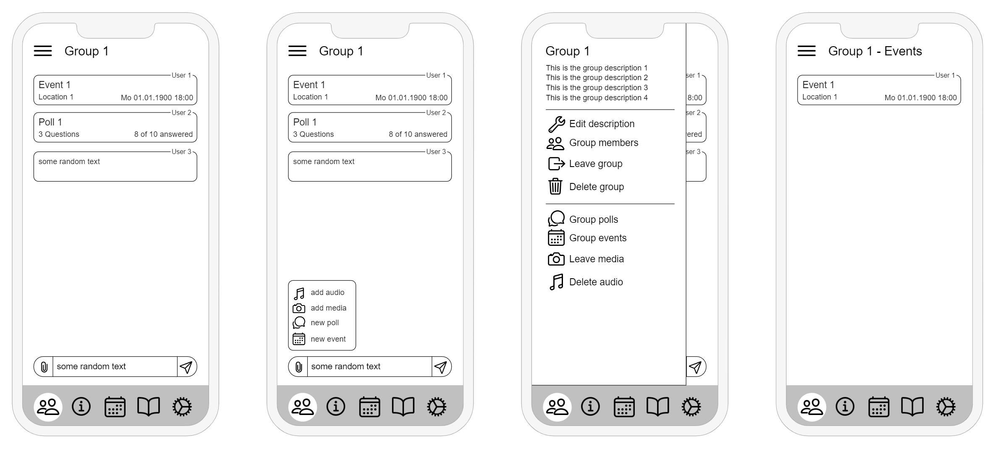
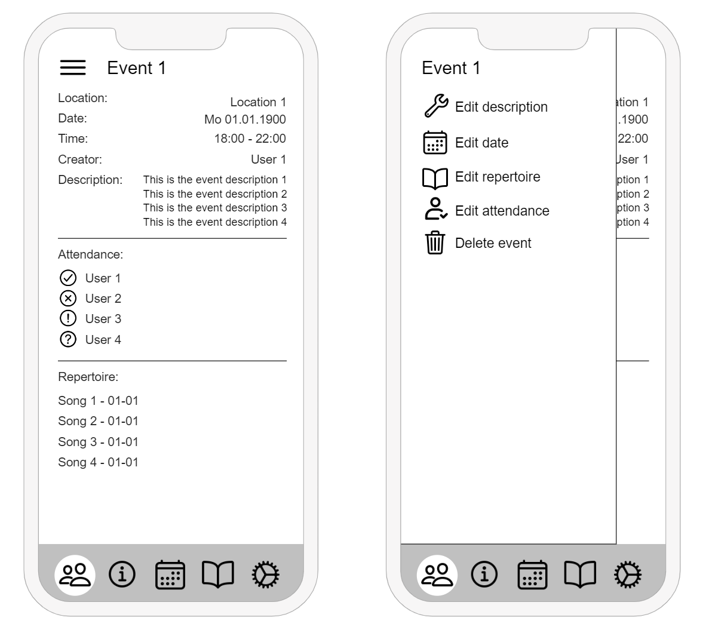

# Mockup

## General

The mobile application should be tab-structured. These tabs should be route independent, so that upon resvisiting that tap the route persists. To acces this tab-view the user has to be logged in. As part of this project I will be implementing the following tabs:

- Comunity
- User

## Splashscreen, Login & Register

The mobile application should contain an inviting splash screen. Further should there a page for eather login or register purposes. The login page should link to the register page and vise versa. The fields of the register-page should validate the input before sending the register request to the backend. The implementation should also contain (not shown within the mockup) a second password field to confirm the password-input. Upon login or register you will be routed to the community page.

## Community

The community tab is the main interaction-window with groups. Here are all groups listed where the user is part of. Upon click on a group the user is rerouted to the group specific group-page. The cummunity menu contains the option to create a new group. In the future there is the possibility to add further features within this menu like band-filters, group-name search, group-member search and so on.

On the group-page the user is presented with the group specifics notification, containing events, polls and chat-messages, ordered by time. Further is there a chat bar at the bottom with a chat-input, send-message button and small menu to create group specific polls and events as well as send media and audio. The group menu displays the group-description and gives some options for the group like editing description, managing members and so on. Besides the options the menu allows to view the group-content filtered for events, polls, media or audio. Upon click on a poll or event the poll-/event-page will be opened. As part of this project I will be implementing the following features of this mockup.

- Display group-content
- Events and polls
- Edit group description
- Group members page
- Leave group
- Delete group
- Group and poll filter
- New poll
- New event

The event-page can be accessed through clicking on a event within the group-page. The event page displays all relevant event information including attendance and repertoire. The event menu gives the option to edit the event information as well as group deletion. As part of this project the following features of events will be implemented.

- Event information (location, date, time, description)
- Edit description
- Edit date
- Delete event

The poll-page will behave similarly to the event page. For the creation page of polls and events further research in to ionic components is still needed to define the implementation as well as look and feel.

## User

